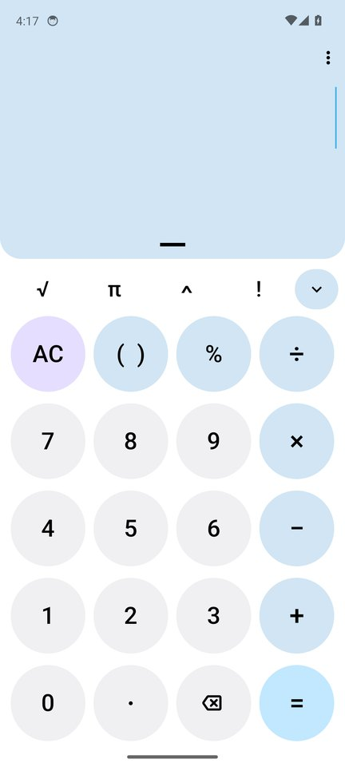
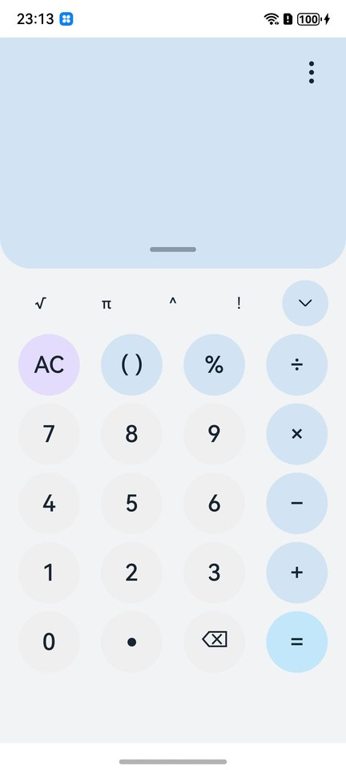
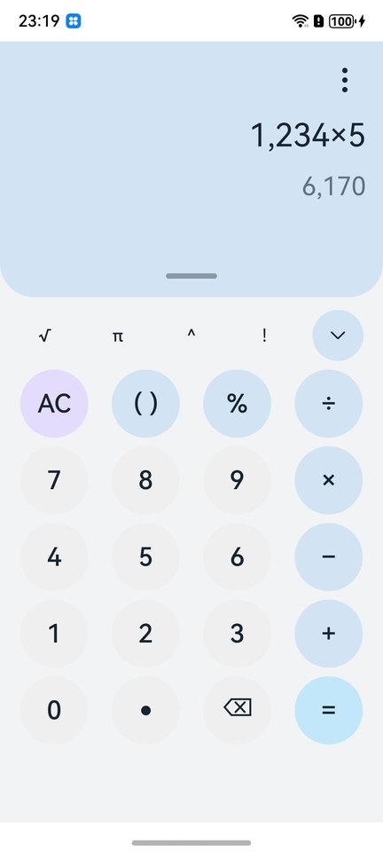
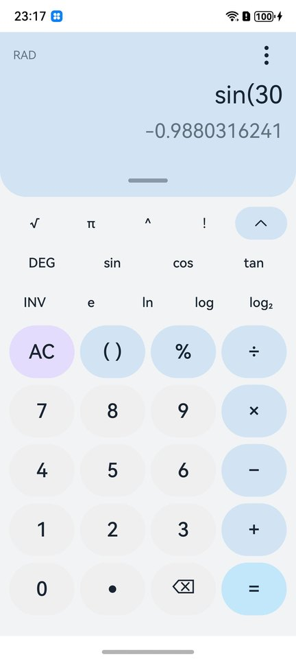
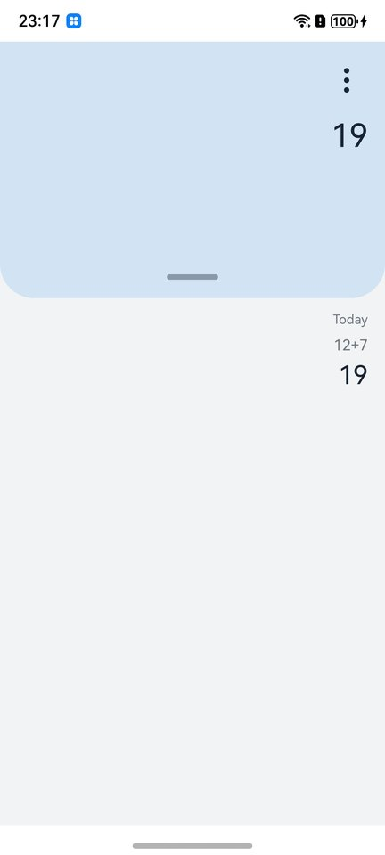
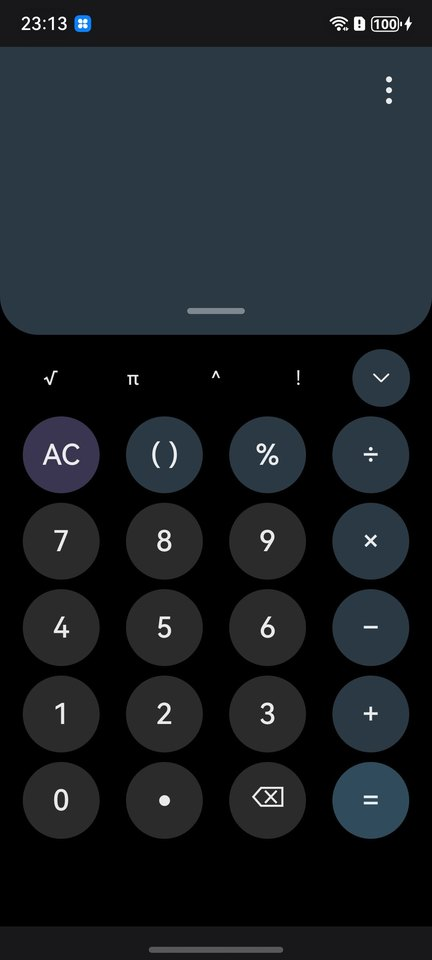
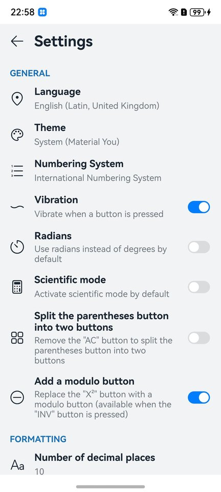
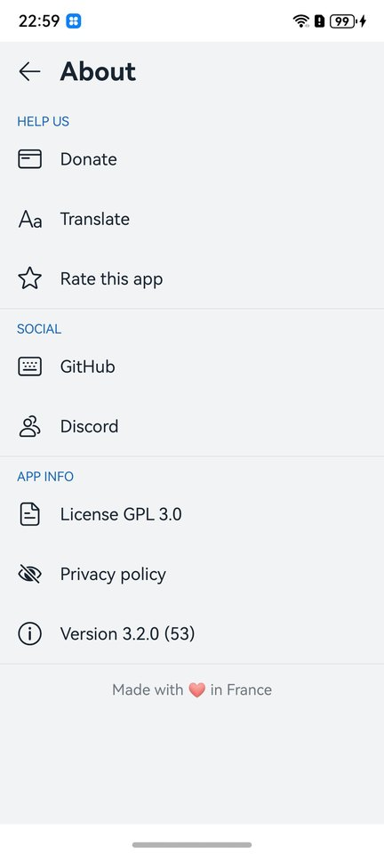

# OpenCalc for OpenHarmony

A port of [OpenCalc](https://github.com/Darkempire78/OpenCalc), Darkempire78's open-source Android calculator, to OpenHarmony and Oniro. It is written in ArkTS with ArkUI (state management V2) and runs on API 23.

| Android original | This port |
|---|---|
|  |  |

   

 

## What it does

The port follows OpenCalc 3.2 (commit `0584d61`):

- a live result line under the input, with grouping separators (international or Indian numbering);
- the scientific keys: degrees and radians, inverse functions, trigonometry, logarithms, powers, roots, factorial, modulo;
- the original's own expression parser and rounding rules, ported from `Calculator.kt` and `Expression.kt`, with unit tests for the parser and the number formatting;
- a history panel that slides down from the display and survives restarts;
- the Settings page (theme, numbering system, precision, history size, vibration, keep awake and the other switches) and the About page;
- light, dark and Amoled themes.

## What differs from the original

Left out because OpenHarmony has no counterpart, or it was out of the port's scope:

- the quick settings tile and showing over the lock screen;
- the wallpaper-derived Material You palette (the System theme follows the system's light or dark mode);
- the per-app language picker and the translations: the port is in English, and the Language row shows the system language;
- the landscape and tablet layouts.

Known rough edges:

- the keys are a little smaller than the original's, which leaves a band under the keypad;
- the decimal point key shows a large dot;
- the Amoled theme's pure black applies to the calculator only; Settings and About use the dark background.

## Build and install

You need the OpenHarmony SDK (API 23), the OpenHarmony command-line tools, and the [`oniro-app`](https://www.npmjs.com/package/@oniroproject/oniro-app) CLI.

```sh
oniro-app build          # builds a signed HAP under entry/build/default/outputs/default/
oniro-app app install    # installs it on the connected device or emulator
oniro-app app launch
```

The repository carries the OpenHarmony SDK's public development signing material (`signatures/`), so it builds signed as it is. That material is for development only: run `oniro-app sign` to generate your own.

The unit tests are under `entry/src/ohosTest`.

## How it was made

The port was produced by an automated app factory: it reads the Android source and records the app on an emulator, writes a specification (`.factory/appspec.json`), has coding agents implement it, and checks the result on a device against the original's recorded behaviour and screenshots. The commit history is the factory's own, one commit per work item and iteration. No code was written by hand.

## Licence and credits

OpenCalc is by [Darkempire78](https://github.com/Darkempire78) and its contributors, licensed under the GNU General Public License v3.0. This port is a derivative work under the same licence; see [LICENSE](LICENSE). The launcher icon is the original's.
